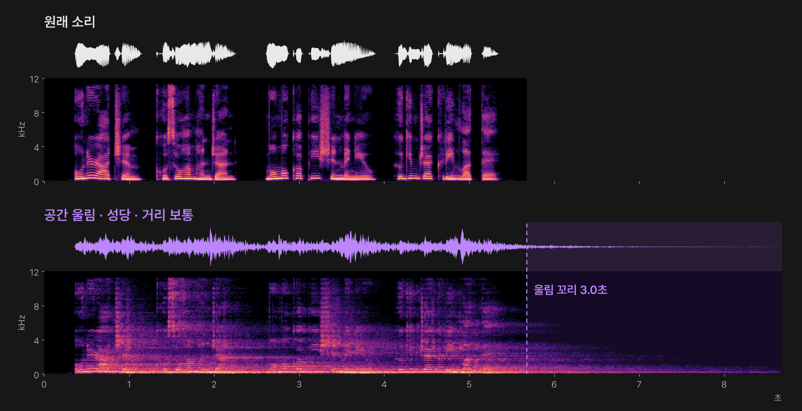
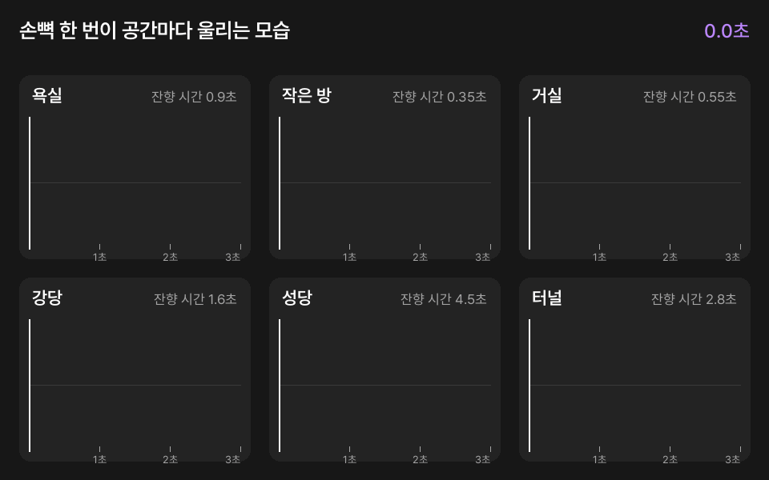
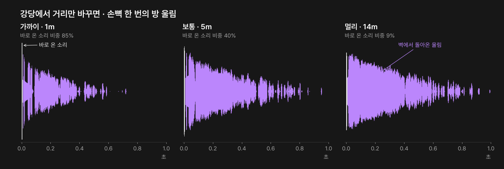
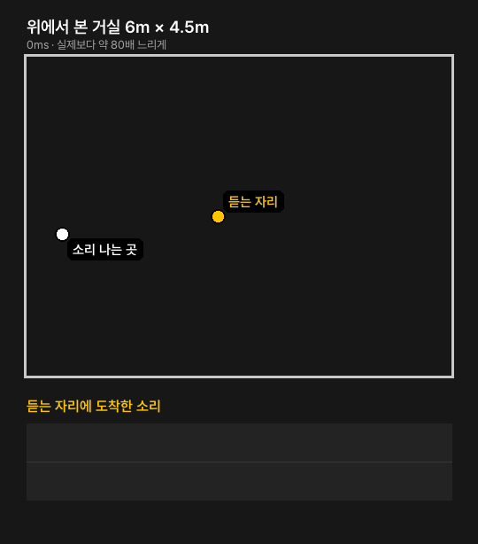
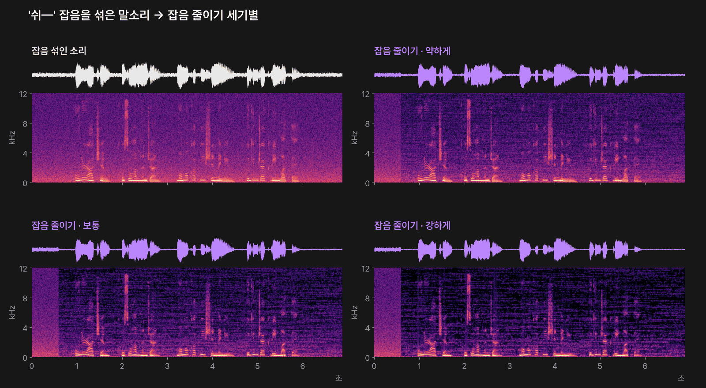
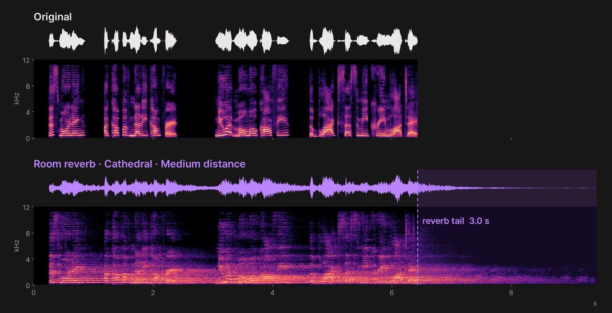
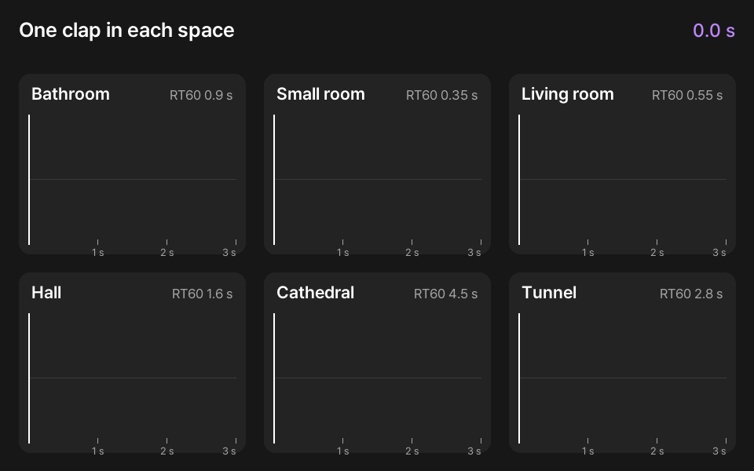
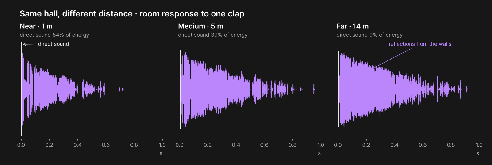
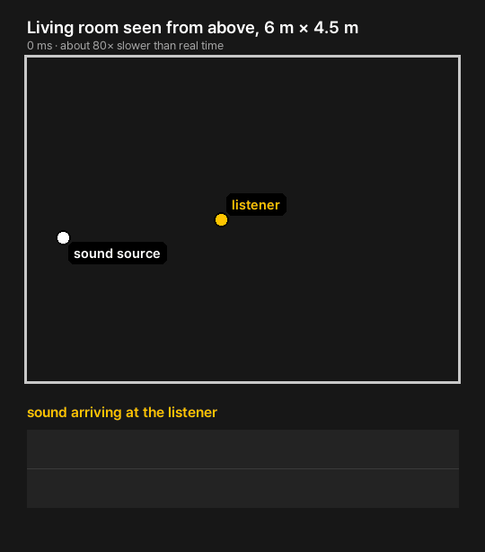
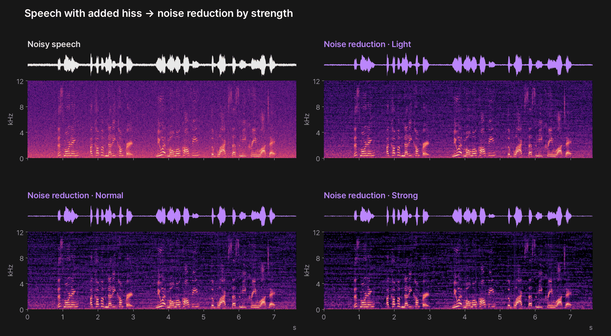

# 공간 울림 · 잡음 줄이기 (PromBoard 플러그인)

[English](#english)

소리에 욕실 · 거실 · 성당 같은 실제 공간의 울림을 입히거나, 말소리 뒤의 잡음을 줄이는 PromBoard 커뮤니티 플러그인입니다. 오픈소스 [pyroomacoustics](https://github.com/LCAV/pyroomacoustics)(MIT)의 방 시뮬레이션과 잡음 줄이기 기능을 씁니다. AI 모델을 받지 않고, 그래픽카드 없이 이 PC 의 CPU 로 몇 초 안에 끝납니다.



위는 원래 말소리, 아래는 공간 울림(성당, 거리 보통)을 입힌 소리입니다. 각 소리의 위 띠는 파형, 아래 띠는 스펙트로그램(가로 = 시간, 세로 = 소리 높낮이, 밝을수록 큰 소리)입니다. 말소리 사이 빈틈이 울림으로 채워지고, 말이 끝난 뒤에도 울림 꼬리가 3초 이어집니다. [원래 소리 듣기](docs/ko/audio/original.mp3?raw=true) · [성당 듣기](docs/ko/audio/reverb-cathedral.mp3?raw=true)

- 플러그인 id: `promboard.room-acoustics`
- 필요한 앱: PromBoard 1.0.2 이상
- 라이선스: MIT

## 설치

1. PromBoard 홈 왼쪽 [플러그인] → 커뮤니티 플러그인에서 「공간 울림 · 잡음 줄이기」를 설치합니다.
2. 커뮤니티 플러그인이라 제한 모드를 끄고 플러그인을 켭니다.
3. 처음 한 번 [실행 준비]를 누릅니다. 파이썬과 패키지를 로컬 AI 모델 폴더에 받습니다(받는 양 약 100MB, 디스크 약 250MB — 다른 플러그인이 이미 받은 파이썬 · uv 는 다시 받지 않습니다). Windows PC 에서 10초 남짓 걸렸습니다.

## 쓰는 법

**캔버스 노드**: 노드 추가 목록에서 「공간 울림 · 잡음 줄이기」를 놓고 소리 노드를 연결한 뒤 ▷ 를 누릅니다.

**렌더 탭**: 소리 클립을 오른쪽 클릭 → [오디오 효과 ›] → 「공간 울림 · 잡음 줄이기」 → 설정을 고르고 [효과 입히기]. 효과를 입힌 소리는 같은 클립에 새 버전으로 들어가고, [효과 되돌리기]로 원래 소리로 돌아갈 수 있습니다.

## 설정

| 설정 | 고르는 것 | 뜻 |
|---|---|---|
| 모드 | 공간 울림 · 잡음 줄이기 | 공간 울림은 고른 공간에서 녹음한 것처럼 울림을 입힙니다. 잡음 줄이기는 말소리 뒤의 '쉬—' 하는 잡음을 줄입니다 |
| 공간 | 욕실 · 작은 방 · 거실 · 강당 · 성당 · 터널 | 공간 울림일 때만 씁니다. 욕실은 짧고 또렷하게, 성당 · 터널은 길게 울립니다 |
| 거리 | 가까이 · 보통 · 멀리 | 공간 울림일 때만 씁니다. 멀수록 울림이 커지고 소리가 멀게 들립니다 |
| 잡음 줄이기 세기 | 약하게 · 보통 · 강하게 | 잡음 줄이기일 때만 씁니다. 강할수록 잡음이 더 줄지만 말소리가 뭉개질 수 있습니다 |



손뼉 한 번이 공간마다 얼마나 오래 울리는지 그린 움짤입니다(거리 보통). 세로는 소리 크기(dB, 위아래 대칭), 가로는 시간입니다. 잔향 시간은 소리가 60dB 줄어드는 데 걸리는 시간이고, 3초를 넘는 울림은 3초에서 끊습니다.



같은 강당에서도 멀어질수록 바로 온 소리의 비중이 줄고 벽에서 돌아온 울림이 커집니다.

## 들어 보기

| 무엇 | 소리 파일(mp3, 누르면 내려받습니다) |
|---|---|
| 원래 소리 | [듣기](docs/ko/audio/original.mp3?raw=true) |
| 공간 울림 · 거리 보통 | [욕실](docs/ko/audio/reverb-bathroom.mp3?raw=true) · [작은 방](docs/ko/audio/reverb-small-room.mp3?raw=true) · [거실](docs/ko/audio/reverb-living-room.mp3?raw=true) · [강당](docs/ko/audio/reverb-hall.mp3?raw=true) · [성당](docs/ko/audio/reverb-cathedral.mp3?raw=true) · [터널](docs/ko/audio/reverb-tunnel.mp3?raw=true) |
| 공간 울림 · 강당 | [가까이](docs/ko/audio/reverb-hall-near.mp3?raw=true) · [보통](docs/ko/audio/reverb-hall.mp3?raw=true) · [멀리](docs/ko/audio/reverb-hall-far.mp3?raw=true) |
| 잡음 줄이기 | [잡음 섞인 소리](docs/ko/audio/noisy.mp3?raw=true) → [약하게](docs/ko/audio/denoise-light.mp3?raw=true) · [보통](docs/ko/audio/denoise-normal.mp3?raw=true) · [강하게](docs/ko/audio/denoise-strong.mp3?raw=true) |

소리와 파형 · 스펙트로그램을 함께 보는 영상(mp4, 재생 위치 선이 움직입니다): [공간 울림 6가지](docs/ko/listen-spaces.mp4?raw=true) · [잡음 줄이기 세기별](docs/ko/listen-denoise.mp4?raw=true)

말소리는 PromBoard 튜토리얼 내레이션(Seed Audio 로 만든 소리)입니다. 잡음 섞인 소리는 이 말소리 앞뒤에 0.6초씩 빈 곳을 두고, 말소리보다 10dB 작은 '쉬—' 잡음을 섞어 만들었습니다. 결과는 이 저장소의 `nodes/main.py` 를 그대로 돌려 얻었고 mp3(96kbps)로 줄였습니다. GitHub 화면 안에서는 소리 · 영상이 재생되지 않아서 링크를 누르면 파일을 내려받습니다.

## 어떻게 동작하나

- **공간 울림**: pyroomacoustics 의 상자 모양 방 시뮬레이션(`ShoeBox`)으로 방 울림(임펄스 응답)을 계산해 소리에 입힙니다. 이른 반사는 거울상 음원법, 늦은 울림은 광선 추적으로 계산합니다. 벽이 소리를 먹는 정도는 공간마다 정한 잔향 시간(RT60)에서 거꾸로 계산합니다(`pra.inverse_sabine`). 귀 사이 거리만큼 떨어진 마이크 두 개로 받아 결과는 스테레오입니다. 소리가 듣는 사람까지 가는 시간만큼은 앞에서 잘라 원래 소리와 박자가 맞고, 끝에 울림 꼬리(최대 3초)가 붙습니다. 크기는 원래 소리와 비슷하게 맞춥니다.
- **잡음 줄이기**: pyroomacoustics 의 스펙트럼 빼기(`denoise.SpectralSub`)를 채널마다 돌립니다. 0.6초 안에서 가장 작은 소리를 잡음으로 보고 뺍니다. 말소리에 맞춘 방식이라 길게 끄는 음악은 소리가 뭉개질 수 있습니다.
- 읽는 형식: wav · mp3 · flac · ogg(m4a · aac · webm 은 못 읽습니다). 결과는 WAV 입니다. 한 번에 10분까지 처리합니다(렌더 탭은 클립 300초까지).
- 인터넷을 쓰지 않습니다. 소리는 이 PC 밖으로 나가지 않습니다.



공간 울림이 계산하는 일을 위에서 본 2D 그림으로 옮긴 움짤입니다. 소리 나는 곳(흰 점)에서 퍼진 소리가 벽에 부딪혀 돌아오고, 듣는 자리(노란 점)에는 바로 온 소리 뒤로 벽에서 돌아온 소리가 겹겹이 도착합니다. 이렇게 도착한 소리를 모은 것이 방 울림(임펄스 응답)입니다. 움짤은 설명용 2D 파동 계산이고, 플러그인은 같은 방을 바닥 · 천장까지 넣은 3D 로 계산합니다. 소리 나는 곳과 듣는 자리는 플러그인이 거실 · 거리 보통에서 쓰는 자리와 같습니다.



스펙트로그램 전체에 고르게 깔린 보라색이 잡음이고, 밝은 가로 줄무늬가 말소리입니다. 세기를 올릴수록 잡음이 더 어두워집니다. 소리 처음 0.6초는 잡음 크기를 재는 동안이라 잡음이 그대로 남습니다.

## 파일

```
manifest.json                 플러그인 정보 · 노드 정의
icon.png
nodes/main.py                 노드 코드
nodes/requirements.in         직접 쓰는 패키지
nodes/requirements-*.txt      운영체제별 해시 잠금 파일(uv pip compile --generate-hashes, Python 3.12)
docs/                         이 README 의 그림 · 움짤 · 소리 · 영상(ko · en). 플러그인 zip 에는 넣지 않는다
```

레지스트리에 올리는 zip 은 PromBoard 앱 저장소의 `server/src/tools/packPlugin.ts` 로 만듭니다. `packPlugin.ts` 는 넘겨받은 폴더를 통째로 묶으므로 `git archive HEAD` 로 꺼낸 폴더를 넘깁니다. `.gitattributes` 의 `export-ignore` 로 `docs/` 가 빠집니다.

## 함께 쓰는 오픈소스

| 패키지 | 라이선스 |
|---|---|
| [pyroomacoustics](https://github.com/LCAV/pyroomacoustics) 0.10.1 | MIT |
| numpy · scipy | BSD-3-Clause |
| [soundfile](https://github.com/bastibe/python-soundfile) 0.14.0 (libsndfile 포함) | BSD-3-Clause (libsndfile: LGPL-2.1) |
| Cython · cffi · pycparser · typing-extensions | Apache-2.0 · MIT · BSD-3-Clause · PSF |

패키지는 실행 준비 때 PyPI 에서 받습니다. 이 저장소에는 들어 있지 않습니다.

---

## English

**Room Reverb · Noise Reduction** is a PromBoard community plugin. It adds the reverb of a real space (bathroom, living room, cathedral, …) to a sound, or reduces the background noise behind speech. It uses the room simulation and denoising features of the open-source [pyroomacoustics](https://github.com/LCAV/pyroomacoustics) (MIT). No AI model is downloaded, and it runs on the CPU of this PC in a few seconds.



Top: the original speech. Bottom: the same speech with room reverb (Cathedral, medium distance). For each sound the upper strip is the waveform and the lower strip is the spectrogram (time to the right, pitch upward, brighter = louder). The gaps between words fill with reverb, and a 3-second reverb tail follows the last word. [Listen to the original](docs/en/audio/original.mp3?raw=true) · [Listen to the cathedral](docs/en/audio/reverb-cathedral.mp3?raw=true)

- Plugin id: `promboard.room-acoustics`
- Requires PromBoard 1.0.2 or later
- License: MIT

### Install

1. In PromBoard Home, open **Plugins** → **Community plugins** and install "공간 울림 · 잡음 줄이기".
2. It is a community plugin, so turn off restricted mode and turn the plugin on.
3. Press **Prepare** once. Python and the packages are downloaded into the local AI model folder (about 100 MB to download, about 250 MB on disk; Python and uv already fetched for another plugin are reused).

### Use

**Canvas node**: add the node, connect an audio node and press ▷.

**Render tab**: right-click an audio clip → **Audio effects ›** → pick the effect → choose the settings → **Apply effect**. The processed sound goes into the same clip as a new version, and **Undo effect** brings back the original sound.

### Settings

| Setting | Options | Meaning |
|---|---|---|
| Mode | Room reverb · Noise reduction | Room reverb makes the sound feel recorded in the chosen space. Noise reduction lowers the hiss behind speech |
| Space | Bathroom · Small room · Living room · Hall · Cathedral · Tunnel | Room reverb only. Bathrooms ring short and bright, cathedrals and tunnels ring long |
| Distance | Near · Medium · Far | Room reverb only. Farther means more reverb and a more distant sound |
| Noise reduction strength | Light · Normal · Strong | Noise reduction only. Stronger removes more noise but can smear speech |

The setting labels inside the app are in Korean for now (the plugin format takes one language).



How long one clap rings in each space (medium distance). The height is the level in dB (mirrored up and down), the horizontal axis is time. RT60 is the time it takes the sound to drop by 60 dB; reverb longer than 3 seconds is cut at 3 seconds.



In the same hall, moving farther away lowers the share of the direct sound and raises the reflections from the walls.

### Listen

| What | Sound files (MP3, click to download) |
|---|---|
| Original | [listen](docs/en/audio/original.mp3?raw=true) |
| Room reverb · medium distance | [Bathroom](docs/en/audio/reverb-bathroom.mp3?raw=true) · [Small room](docs/en/audio/reverb-small-room.mp3?raw=true) · [Living room](docs/en/audio/reverb-living-room.mp3?raw=true) · [Hall](docs/en/audio/reverb-hall.mp3?raw=true) · [Cathedral](docs/en/audio/reverb-cathedral.mp3?raw=true) · [Tunnel](docs/en/audio/reverb-tunnel.mp3?raw=true) |
| Room reverb · Hall | [Near](docs/en/audio/reverb-hall-near.mp3?raw=true) · [Medium](docs/en/audio/reverb-hall.mp3?raw=true) · [Far](docs/en/audio/reverb-hall-far.mp3?raw=true) |
| Noise reduction | [Noisy speech](docs/en/audio/noisy.mp3?raw=true) → [Light](docs/en/audio/denoise-light.mp3?raw=true) · [Normal](docs/en/audio/denoise-normal.mp3?raw=true) · [Strong](docs/en/audio/denoise-strong.mp3?raw=true) |

Videos with the sound, waveform and spectrogram together (MP4, a line follows the playback position): [six spaces](docs/en/listen-spaces.mp4?raw=true) · [noise reduction strengths](docs/en/listen-denoise.mp4?raw=true)

The speech is the PromBoard tutorial narration (made with Seed Audio). The noisy speech adds 0.6 s of silence before and after it and mixes in a hiss 10 dB quieter than the speech. All results come from running this repository's `nodes/main.py` as is, encoded to MP3 (96 kbps). GitHub does not play audio or video inside the page, so the links download the files.

### How it works

- **Room reverb**: computes a room impulse response with pyroomacoustics' shoebox room simulation (image source method for early reflections, ray tracing for the late tail) and convolves the sound with it. Wall absorption is derived from each space's reverberation time (RT60) with `pra.inverse_sabine`. Two microphones spaced like human ears give a stereo result. The travel time to the listener is trimmed so the result stays in sync with the original, and a reverb tail (up to 3 s) is added at the end. The loudness is matched to the original.
- **Noise reduction**: runs pyroomacoustics' spectral subtraction (`denoise.SpectralSub`) on each channel, using the minimum level within 0.6 s as the noise estimate. It is tuned for speech; long sustained music notes may get smeared.
- Reads wav · mp3 · flac · ogg (not m4a · aac · webm). Writes WAV. Up to 10 minutes at a time (the render tab sends clips of up to 300 s).
- No internet access. The sound never leaves this PC.



What room reverb computes, drawn as a 2D view from above. Sound spreads from the source (white dot) and bounces off the walls; the listener (yellow dot) receives the direct sound first and then layer after layer of reflections. Those arrivals together are the room impulse response. The animation is an illustrative 2D wave simulation; the plugin computes the same room in 3D, including floor and ceiling. The source and listener positions are the ones the plugin uses for Living room at medium distance.



The even purple layer across the whole spectrogram is the noise; the bright horizontal stripes are the speech. Higher strength makes the noise darker. The first 0.6 s keeps its noise because the plugin is still measuring the noise level.

### Third-party open source

pyroomacoustics 0.10.1 (MIT), numpy · scipy (BSD-3-Clause), soundfile 0.14.0 (BSD-3-Clause, bundles libsndfile under LGPL-2.1), Cython (Apache-2.0), cffi (MIT), pycparser (BSD-3-Clause), typing-extensions (PSF). The packages are downloaded from PyPI during **Prepare** and are not included in this repository.

The `docs/` folder holds the pictures, animations, sounds and videos for this README and is left out of the plugin zip. `packPlugin.ts` (PromBoard app repository, `server/src/tools/`) packs whatever folder it is given, so pass it a folder exported with `git archive HEAD`; `.gitattributes` (`export-ignore`) drops `docs/` there.
